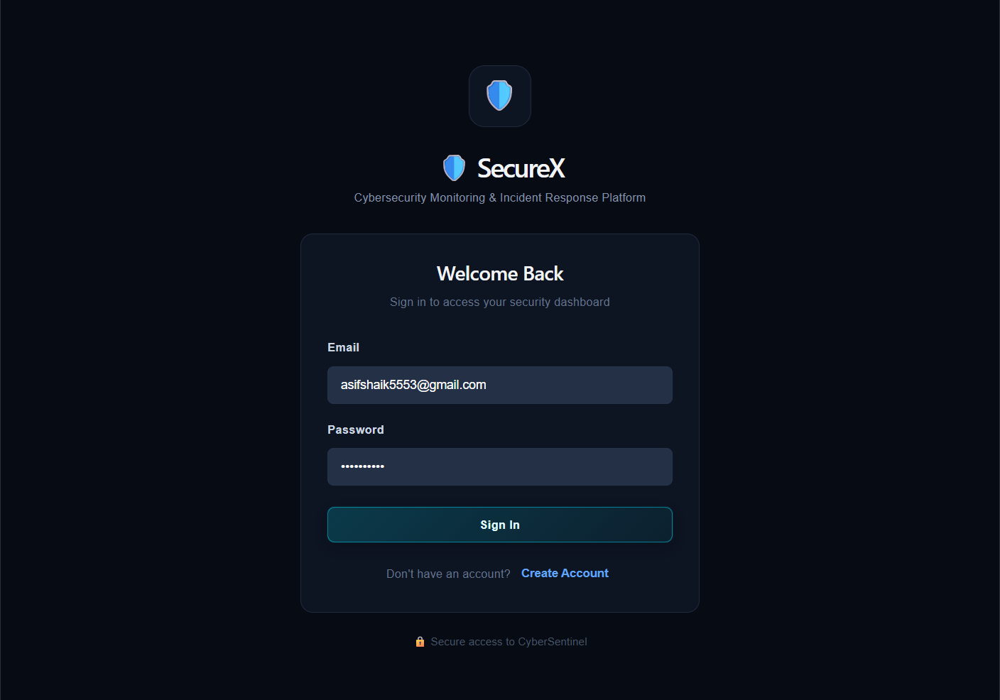
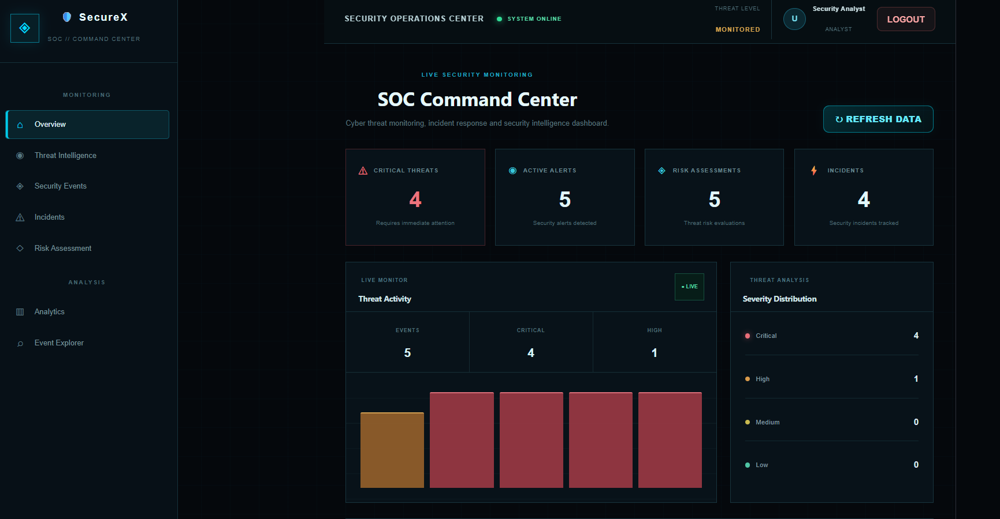
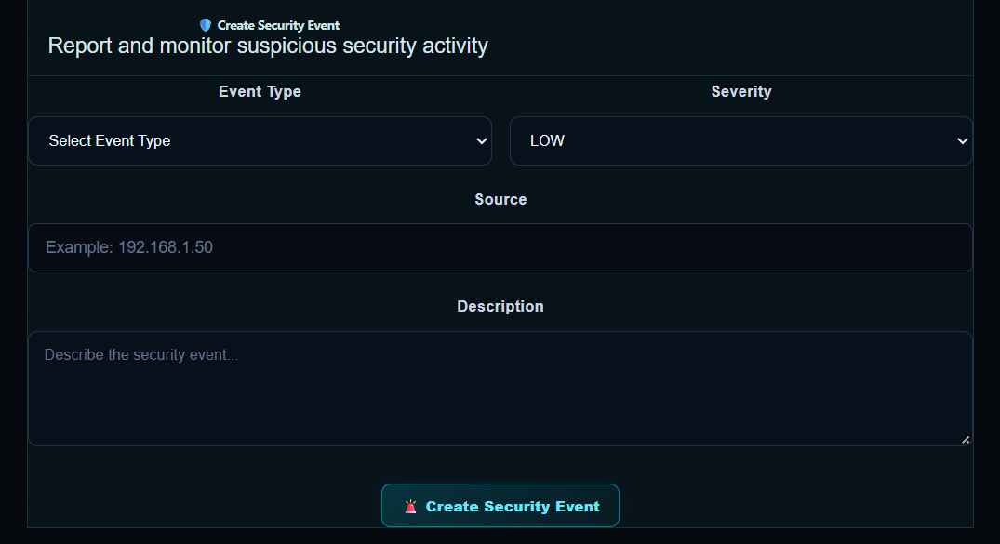
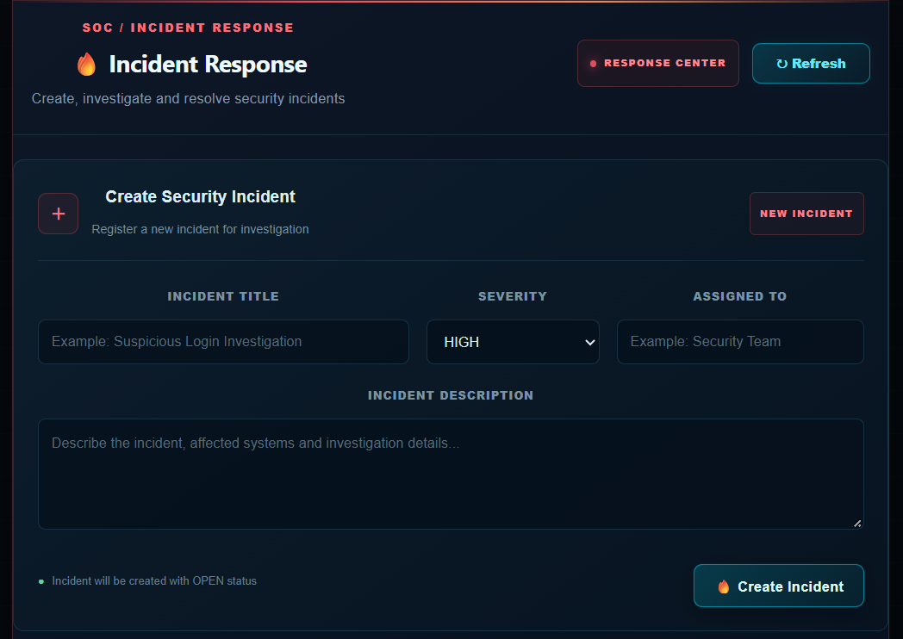

# 🛡️ SecureX — Cybersecurity Monitoring & Incident Response Platform

## 📌 Project Overview

SecureX is a full-stack cybersecurity monitoring platform designed to help security analysts monitor security events, identify potential threats, assess risks, and manage security incidents through a centralized dashboard.

## 🎯 Objectives

* Monitor and manage security events.
* Identify suspicious activities and potential cyber threats.
* Assess security risks and their severity.
* Track and manage security incidents.
* Provide secure authentication and role-based access.
* Maintain audit logs for administrative activities.

## ✨ Key Features

* 🔐 User registration and login
* 📊 Security monitoring dashboard
* 🚨 Security event management
* ⚠️ Risk assessment
* 🛡️ Incident management
* 📈 Security analytics
* 👥 User management for administrators
* 📋 Audit logs

## 🧰 Technologies Used

### Frontend

* React.js
* JavaScript
* HTML5
* CSS3
* Axios

### Backend

* Java 21
* Spring Boot
* Spring Security
* Spring Data JPA
* JWT authentication

### Database

* MySQL

### Development Tools

* Visual Studio Code
* Apache Maven
* Git
* GitHub

## 🏗️ Architecture

React Frontend → REST API → Spring Boot Backend → MySQL Database

## ⚙️ Prerequisites

* Java 21
* Apache Maven, if not using the Maven wrapper
* Node.js and npm
* MySQL Server
* Git

## ▶️ How to Run

### 1. Clone the repository

```bash
git clone https://github.com/asifshaik60801-bot/SecureX-Cybersecurity-Monitoring-Platform.git
cd SecureX-Cybersecurity-Monitoring-Platform
```

### 2. Configure the database

Create the MySQL database:

```sql
CREATE DATABASE cybersentinel_db;
```

Configure your local environment variables before starting the backend:

* `DB_USERNAME` — your MySQL username
* `DB_PASSWORD` — your MySQL password
* `JWT_SECRET` — a strong, randomly generated JWT signing secret

Never commit actual passwords or JWT secrets to GitHub.

### 3. Start the backend

Open a terminal in the backend directory:

```bash
cd backend
mvn spring-boot:run
```

The backend uses port `8081`.

### 4. Start the frontend

Open a second terminal:

```bash
cd frontend
npm install
npm run dev
```

Open the local frontend address displayed in your terminal, usually `http://localhost:5173`.

## 🔒 Security Notes

* Keep database credentials and JWT signing secrets private.
* Use HTTPS and secure production configuration before deployment.
* Restrict access to administrative functions.
* Validate and authorize API requests on the backend.

## 🎓 Project Type

Academic Full-Stack Development Project

## 👨‍💻 Author

**Asif Shaik**

## 📄 Disclaimer

SecureX is an academic project intended for learning and demonstration. Its security capabilities depend on the implemented features and configuration.
## 📸 Project Screenshots

### 🔐 Login Page



### 📊 Security Dashboard



### 🚨 Security Events



### 🛡️ Incident Management




